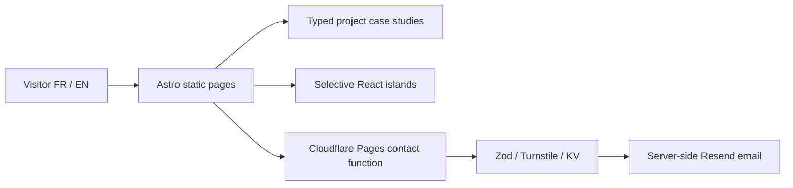

<!-- appfactory:hero:start -->
<div align="center">

# AgenStudio

### Crafted digital experiences. Built for real-world use.

**An independent bilingual digital studio presence from Cameroon, pairing deliberately lightweight web engineering with selected project case studies.**

[](#project-status)
[](#what-the-site-includes)
[](#website-and-contact-architecture)
[](#deployment)

[**Studio**](#why-agenstudio) · [**Architecture**](#website-and-contact-architecture) · [**Evidence**](#maturity-and-evidence) · [**Stack**](#stack) · [**Local setup**](#development) · [**Projects**](#project-content) · [**License**](#license)

</div>

---
<!-- appfactory:hero:end -->

## Why AgenStudio

**A studio site should show work, not just describe talent.** AgenStudio gives an independent digital studio a bilingual destination for services, selected case studies and client inquiries. The technical experience is deliberately static-first and does not inherit the Trigenys product brand.

## Website and contact architecture



Contact tokens and anti-abuse credentials remain server-side. The site includes accessibility and reduced-motion patterns; this alone is not an accessibility certification.

## Maturity and evidence

**Beta website:** the project collections, internationalization and contact handling are implemented in this repository. Operational deliverability depends on deployed Cloudflare bindings and email-provider configuration. Featured case studies are curated content, not a claim of audited client results. See [case study source](src/content/projects/), [contact implementation](functions/api/contact.ts) and the existing proprietary [license](LICENSE).

**Official bilingual website for AgenStudio, an independent digital studio building modern web products from Cameroon.**

The site presents the studio, its areas of expertise and selected projects in French and English. It is built as a mostly static Astro site, with React used only where interaction is needed.

## What the site includes

- bilingual **FR / EN** navigation and content;
- project case studies powered by typed content collections;
- responsive service and portfolio pages;
- SEO metadata, hreflang and sitemap generation;
- contact form with validation and abuse protection;
- reduced-motion support and accessible interaction patterns;
- Cloudflare Pages deployment.

## Stack

- **Astro 7** + TypeScript
- **React 18** islands for interactive components
- **Tailwind CSS 3**
- **MDX / Astro Content Collections**
- **Cloudflare Pages** + Pages Functions
- **Resend** for contact email delivery
- **Cloudflare Turnstile** for bot protection
- **Zod** for shared form validation

## Architecture

```text
Static Astro pages
      │
      ├── React islands for interaction
      │
      ├── typed project content
      │
      └── SEO / i18n metadata

Contact form
      │
      ▼
Cloudflare Pages Function
      ├── Zod validation
      ├── Turnstile verification
      ├── KV rate limiting / idempotency
      └── Resend
```

The site deliberately keeps client-side JavaScript limited to the parts that need it: navigation, filters and forms. Project content is stored as typed data rather than being hard-coded into page components.

## Development

### Requirements

- Node.js
- npm

### Setup

```bash
git clone https://github.com/EagleFox31/agenStudio.git
cd agenStudio
npm install
cp .env.example .env
npm run dev
```

The local site is served by Astro, typically at `http://localhost:4321`.

### Useful commands

```bash
npm run dev      # local development
npm run build    # production build
npm run preview  # preview the build
npm run check    # Astro + TypeScript checks
npm run lint     # ESLint
npm run format   # Prettier
```

## Environment variables

Copy `.env.example` to `.env` and configure the services required for the contact form:

```env
SITE_URL=
PUBLIC_TURNSTILE_SITE_KEY=
TURNSTILE_SECRET_KEY=
RESEND_API_KEY=
CONTACT_TO_EMAIL=
CONTACT_FROM_EMAIL=
```

Secrets stay server-side. Only the Turnstile site key is exposed to the browser.

## Contact form security

The production form includes:

- strict Zod validation shared between client and server;
- honeypot detection;
- server-side Turnstile verification;
- rate limiting through Cloudflare KV;
- idempotency protection for repeated submissions;
- explicit error handling for invalid configuration and failed email delivery.

The `RATE_LIMIT` KV binding is required for the intended production configuration.

## Project content

- translations and shared copy: `src/lib/i18n.ts`
- case studies: `src/content/projects/`
- SEO and layout: `src/layouts/BaseLayout.astro`
- contact endpoint: `functions/api/contact.ts`

Adding a project means adding a typed content entry that satisfies the project schema.

## Deployment

The site targets **Cloudflare Pages**.

```text
Build command: npm run build
Output directory: dist
Root directory: /
```

Production also requires the environment variables above and the `RATE_LIMIT` KV binding.

## Project status

**Beta.**

The current site is the public-facing foundation for AgenStudio. Content, project case studies and studio positioning continue to evolve while the technical base remains intentionally lightweight and static-first.

## Delivery playbook

The repository also contains the AgenStudio website playbook used to define delivery and acceptance criteria. It documents the broader design and launch process; the README stays focused on the product and how to run it.

## License

The code, original design, copy, project content and original brand assets in this repository are proprietary to **EagleFox31**, published under the **AgenStudio** brand. Public visibility does not grant permission to reuse or redistribute them.

Third-party libraries and assets remain subject to their own licences and ownership terms. See [`LICENSE`](LICENSE).

---

<p align="center">
  <sub>Built by <a href="https://github.com/EagleFox31">EagleFox31</a>.</sub>
</p>
